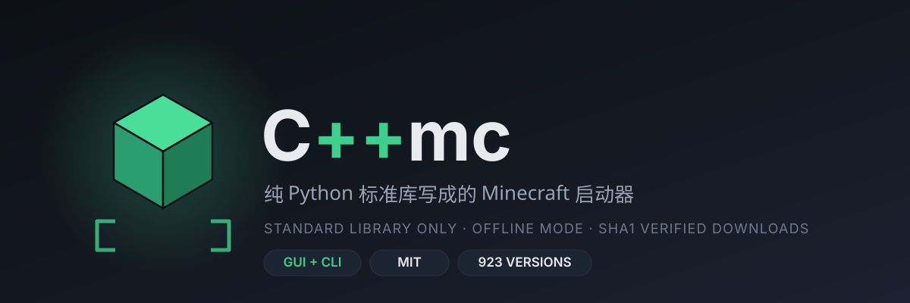

# C++mc

<p align="center">
  
</p>

> 一个用 **纯 Python**（只依赖标准库）写的 Minecraft 启动器。
> 名字叫 C++mc，代码是 Python，游戏是 Java —— 三重叛逆。

<p align="center">
  <a href="https://github.com/gunmigunm/CppMc/releases/latest">
    
  </a>
  <a href="https://github.com/gunmigunm/CppMc/actions/workflows/release.yml">
    
  </a>
</p>

[English](#english) | 中文

---

## 宣传片（13.9 秒）

<p align="center">
  
</p>

<p align="center">
  上面这张动图是宣传片的降采样版（3.9 MB，560px / 8fps）——<br>
  <a href="https://github.com/gunmigunm/CppMc/releases/download/v1.0.0/CppMc_promo.mp4">点这里下 1080p 原片</a>（13.9s / 1920×1080 / 30fps / 3.5 MB）。
</p>

片子是脚本自己剪的：`tools/make_promo_frames.py` 用 Pillow 画 4 张品牌帧，
`tools/build_promo.py` 用 ffmpeg 做 Ken Burns 推拉 + 交叉淡化，最后交叉合成一支 13.9 秒的片子。
里面没有假造任何游戏界面截图 —— 全是品牌帧、代码雨、版本数字和仓库地址。
动图和原片由 GitHub Actions 在每次构建时现场生成，和 exe 一起挂到 Release。

## 下载（Windows 免安装）

不需要装 Python，直接下打包好的单文件 exe：

**[⬇ 下载 CppMc.exe（最新 Release）](https://github.com/gunmigunm/CppMc/releases/latest)**

双击就能开界面。exe 由 GitHub Actions 在每次推送时自动构建，图标、版本、构建日志、宣传片都在 Release 里。

## 这是什么

CppMc（显示名 **C++mc**）是一个能真正把 Minecraft 原版启动起来的启动器：

- 从 Mojang 官方 API 拉取完整版本列表（900+ 个版本，含快照）
- 自动下载客户端 jar、依赖库、natives、资源文件（带 SHA1 校验 + 重试）
- **微软正版账号登录**（设备码流程，登录一次之后自动刷新令牌），也保留完整**离线模式**
- **Java 自动下载**：找不到合适的 Java 就自动从 Adoptium 拉一个 Temurin 装到 `%APPDATA%\CppMc\java`，也可以自己填路径
- 生成 JVM 参数、classpath、游戏参数并启动 `net.minecraft.client.main.Main`
- 现代版本（`arguments` 格式，1.13+）与老版本（`minecraftArguments` 格式，1.12-）都支持
- Tkinter 图形界面 + 命令行两种用法，零第三方依赖

界面是深色主题的，有进度条、实时日志、内存设置、账号状态、Java 路径与自动下载开关。

## 环境要求

| 项目 | 要求 |
| --- | --- |
| Python | 3.9+（仅标准库，无需 pip install） |
| Java | **可选**：没装也行，启动器会按版本需要的版本号自动下载 Temurin（21 → 47MB 左右）；也可以手动指定 |
| 系统 | Windows / macOS / Linux |

## 快速开始

```bash
git clone https://github.com/gunmigunm/CppMc.git
cd CppMc
python CppMc.py
```

图形界面打开后：选版本 → 点「微软登录」或直接填一个离线名字 → 点「启动游戏」。
首次启动会把文件下载到 `%APPDATA%\CppMc\game`（Linux 是 `~/.local/share/CppMc/game`），
下载多大的资源取决于版本；没装 Java 的话会顺手把 Java 也下好。

Windows 上也可以直接双击 `run.bat`。

## 账号：正版 / 离线

| 模式 | 怎么用 | 说明 |
| --- | --- | --- |
| 正版（微软账号） | 界面点「微软登录」，或 `python CppMc.py --login` | 设备码流程：程序给一个 9 位代码，你用自己的浏览器打开 `microsoft.com/link` 输进去，程序自己轮询拿令牌。启动器不会去开你的浏览器，也不会碰你的浏览器资料 |
| 离线 | 什么都不登录，填名字即可 | 用名字生成标准 `OfflinePlayer` UUID（和原版离线模式一致），能玩单人、能连离线服 |

登录后令牌存在 `%APPDATA%\CppMc\account.json`（Unix 下权限 600），快过期时启动器会自动刷新；
`--logout` 或界面「退出登录」会把它删掉，之后回到离线模式。

登录链路遵循第三方启动器的标准流程：
设备码 → 微软令牌 → Xbox Live → XSTS → Minecraft 服务 → 档案（拿 UUID 和名字）。

> 设备码用的是公开的第三方应用注册（`CPMC_MS_CLIENT_ID` 环境变量可以换成你自己在 Azure 注册的
> 公共客户端应用，权限填 `XboxLive.signin` + `offline_access`）。

## Java：自动下载与自定义路径

查找顺序是：**你填的路径 → 本启动器下载过的 Temurin → 系统里已有的 Java（版本号够用就用）→ 自动下载**。

- 自动下载装到 `%APPDATA%\CppMc\java\temurin-<版本号>`，重复启动直接复用，不会重复下载
- 想用自己的 Java：界面「自动检测」或直接填 `java.exe` 路径；命令行 `--java "C:\Path\java.exe"`
- 不想让它自动下载：界面取消勾选，或命令行加 `--no-auto-java`

## 命令行用法

```bash
python CppMc.py --list                        # 列出全部版本
python CppMc.py --install 1.21.5              # 只下载，不启动
python CppMc.py --launch 1.21.5 --name Steve  # 离线模式启动
python CppMc.py --login                       # 微软账号登录（设备码，按提示输码）
python CppMc.py --account                     # 查看当前账号与令牌状态
python CppMc.py --logout                      # 退出登录，回到离线模式
python CppMc.py --launch 26.3 --offline       # 强制离线，即使登录过
python CppMc.py --launch 26.3 --memory 4096   # 指定内存
python CppMc.py --launch 1.12.2 --dry-run     # 只打印启动命令，方便排查
python CppMc.py --java "C:\Path\To\java.exe"  # 手动指定 Java
python CppMc.py --no-auto-java                # 不自动下载 Java
python CppMc.py --game-dir "D:\MC"            # 指定游戏目录
```

所有下载的进度和日志都会打印到终端。

## 项目结构

```
CppMc.py              # 入口，python CppMc.py 直接开图形界面
cppmc/core.py         # 核心：版本元数据、下载、规则解析、参数拼接、启动
cppmc/java.py         # Java 检测、Adoptium 自动下载、版本匹配
cppmc/auth.py         # 微软设备码登录、Xbox/XSTS/Minecraft 链路、令牌缓存
cppmc/cli.py          # 命令行接口
cppmc/ui.py           # Tkinter 界面实现
cppmc/gui.py          # 界面入口（转出 ui.run_gui）
CppMc/__init__.py     # 包导出
assets/               # 启动器自己的图标与横幅（SVG）
tools/                # 图标生成、宣传片帧与剪辑脚本
run.bat               # Windows 一键启动
```

核心逻辑和界面完全解耦：`Launcher` 类不依赖 tkinter，可以直接当库用：

```python
from cppmc import Launcher

launcher = Launcher("D:/MC", log=print)
prepared = launcher.install("1.21.5")
command = launcher.build_command(prepared, username="Steve", java_path="java", memory_mb=2048)
print(command)   # 或 launcher.launch(command, on_line=print)
```

## 实现要点

1. **版本元数据**：`version_manifest_v2.json` 获取版本列表，再按每个版本的 `url` 拉取版本 JSON，缓存在 `versions/<id>/<id>.json`。
2. **规则解析**：完整实现 Mojang 的 `rules`（`os.name` / `os.arch` / `os.version` / `features`，`allow`、`disallow` 顺序覆盖）。
3. **依赖库**：支持 `downloads.artifact`、`downloads.classifiers`（老版本 natives 解压到 `natives/`，`extract.exclude` 生效）、以及 maven `url` 回退；依赖库并发下载。
4. **资源文件**：按 `assetIndex` 的 hash 前两位分目录落到 `assets/objects/ab/abcdef…`；`map_to_resources` 的极老版本（1.5 及以前）会按原始文件名整理到 `<game>/resources`，`virtual` 索引整理到 `assets/virtual/<id>`。
5. **校验**：所有能拿到 SHA1 的文件都会校验；下载用 `.part` 临时文件，成功后原子改名，失败自动重试 3 次并退避。
6. **参数**：现代版本直接读取 JSON 里的 `arguments.game` / `arguments.jvm` 并做 `${…}` 替换，老版本走 `minecraftArguments` + 默认 JVM 参数；离线模式自动去掉 `--clientid` / `--xuid` 这类在线账号参数，登录后把 `--username` / `--uuid` / `--accessToken` / `--userType` 换成正版值。
7. **Java**：按版本 JSON 里的 `javaVersion.majorVersion` 决定需要哪个大版本，缺就从 Adoptium 的 `assets/latest` 接口取 Temurin，下载后校验 SHA256 再解压。
8. **账号**：设备码轮询 → Xbox Live RPS → XSTS（把 `XErr` 常见错误码翻译成人话）→ Minecraft `login_with_xbox` → `profile`，令牌过期前 5 分钟自动用 refresh_token 续期。
9. **线程**：界面在主线程，下载/登录/启动在后台线程，通过 `queue` 回传日志和进度，不会卡界面。

## 已知限制

- **正版登录用的是一个公开的第三方应用注册**：万一那个注册被吊销，登录会报错，这时把 `CPMC_MS_CLIENT_ID` 换成你自己在 Azure 注册的公共客户端应用即可。整条链路没法在仓库里跑 CI 验证（需要真人账号），实测靠自己登录一次。
- **不支持 `inheritsFrom` 版本**（Forge / Fabric / NeoForge 等模组加载器）。遇到这类版本会明确报错而不是装作成功。
- Java 自动下载一次只下载**单个大版本**，不会预装多个；切换很老的版本（比如 1.16.5 要 Java 8）会另外下载一份。
- 没有皮肤、没有国内镜像加速、没有启动器自更新 —— 这些是后续可以加的东西。

## License

MIT，见 [LICENSE](LICENSE)。随便用、随便改。

---

## English

**CppMc** (displayed as **C++mc**) is a Minecraft launcher written in pure Python using
only the standard library. It talks to Mojang's official APIs, downloads the client jar,
libraries, natives and assets (with SHA1 verification), supports both the modern
`arguments` metadata (1.13+) and the legacy `minecraftArguments` format, and launches the
game either with a **Microsoft account** (device-code flow) or in **offline mode**.

Java is optional now: when no suitable runtime is found the launcher downloads Eclipse
Temurin from Adoptium into `%APPDATA%\CppMc\java` (or you keep using your own `--java` path).

```bash
python CppMc.py                       # GUI
python CppMc.py --login               # Microsoft account sign-in
python CppMc.py --launch 1.21.5 --name Steve
```

Game files are never committed here: the launcher fetches them from Mojang's official
API on first run. Vanilla only — `inheritsFrom` mod loader versions are rejected with a
clear error instead of silently failing.
