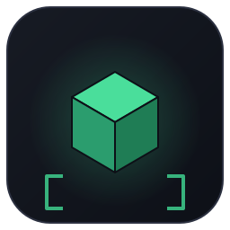

# C++mc

<p align="center">
  
</p>

<p align="center">
  
</p>

> 一个用 **纯 Python**（只依赖标准库）写的 Minecraft 启动器。
> 名字叫 C++mc，代码是 Python，游戏是 Java —— 三重叛逆。

<p align="center">
  <a href="https://github.com/gunmigunm/CppMc/releases/latest">
    
  </a>
  <a href="https://github.com/gunmigunm/CppMc/actions/workflows/release.yml">
    
  </a>
</p>

[English](#english) | 中文

---

## 下载（Windows 免安装）

不需要装 Python，直接下打包好的单文件 exe：

**[⬇ 下载 CppMc.exe（最新 Release）](https://github.com/gunmigunm/CppMc/releases/latest)**

双击就能开界面。exe 由 GitHub Actions 在每次推送时自动构建，图标、版本、构建日志都在 Release 里。

## 这是什么

CppMc（显示名 **C++mc**）是一个能真正把 Minecraft 原版启动起来的启动器：

- 从 Mojang 官方 API 拉取完整版本列表（900+ 个版本，含快照）
- 自动下载客户端 jar、依赖库、natives、资源文件（带 SHA1 校验 + 重试）
- 离线模式登录（用名字生成标准的 `OfflinePlayer` UUID，和原版离线模式一致）
- 生成 JVM 参数、classpath、游戏参数并启动 `net.minecraft.client.main.Main`
- 现代版本（`arguments` 格式，1.13+）与老版本（`minecraftArguments` 格式，1.12-）都支持
- Tkinter 图形界面 + 命令行两种用法，零第三方依赖

界面是深色主题的，有进度条、实时日志、内存设置、Java 自动探测。

## 环境要求

| 项目 | 要求 |
| --- | --- |
| Python | 3.9+（仅标准库，无需 pip install） |
| Java | 与游戏版本匹配的 JDK/JRE（例如最新正式版需要 Java 25，1.16.5 需要 Java 8） |
| 系统 | Windows / macOS / Linux |

## 快速开始

```bash
git clone https://github.com/gunmigunm/CppMc.git
cd CppMc
python CppMc.py
```

图形界面打开后：选版本 → 填玩家名字 → 点「启动游戏」。首次启动会把文件下载到
`%APPDATA%\CppMc\game`（Linux 是 `~/.local/share/CppMc/game`），下载多大的资源取决于版本。

Windows 上也可以直接双击 `run.bat`。

## 为什么仓库里没有游戏文件（客户端 / libraries / assets）

这是有意的，也是必须的：

- **体积**：一个现代版本光 `assets` 就有约 490MB、5000+ 个文件，客户端 jar + 依赖库再加 150MB 左右。GitHub 单文件上限 100MB，硬塞进来只会变成一堆 LFS 垃圾。
- **合规**：Mojang 的游戏资源可以在本机通过官方渠道下载使用，但不允许第三方再分发。所以仓库只放启动器代码，资源一律由启动器从 Mojang 官方接口现拉。
- **效果是一样的**：第一次点「启动游戏」，CppMc 会自动把该版本需要的东西全部下到 `%APPDATA%\CppMc\game`，逐个做 SHA1 校验，失败自动重试；之后再启动就是秒开。

想验证这一点，跑一次 `python CppMc.py --install 26.3`，然后看 `%APPDATA%\CppMc\game` 下的
`versions/`、`libraries/`、`assets/` 三个目录。

仓库里的 `assets/` 只放**启动器自己的**视觉资产（SVG 图标、README 横幅），纯文本格式，可以直接改。

## 命令行用法

```bash
python CppMc.py --list                        # 列出全部版本
python CppMc.py --install 1.21.5              # 只下载，不启动
python CppMc.py --launch 1.21.5 --name Steve  # 下载并启动
python CppMc.py --launch 26.3 --memory 4096   # 指定内存
python CppMc.py --launch 1.12.2 --dry-run     # 只打印启动命令，方便排查
python CppMc.py --java "C:\Path\To\java.exe"  # 手动指定 Java
python CppMc.py --game-dir "D:\MC"            # 指定游戏目录
```

所有下载的进度和日志都会打印到终端。

## 项目结构

```
CppMc.py              # 入口，python CppMc.py 直接开图形界面
cppmc/core.py         # 核心：版本元数据、下载、规则解析、参数拼接、启动
cppmc/cli.py          # 命令行接口
cppmc/gui.py          # Tkinter 图形界面
cppmc/__init__.py     # 包导出
assets/               # 启动器自己的图标与横幅（SVG）
tools/make_icon.py    # 用 Pillow 画图标，CI 里重新生成 .ico
.github/workflows/    # 自动构建 exe 并发 Release
run.bat               # Windows 一键启动
```

核心逻辑和界面完全解耦：`Launcher` 类不依赖 tkinter，可以直接当库用：

```python
from cppmc import Launcher

launcher = Launcher("D:/MC", log=print)
prepared = launcher.install("1.21.5")
command = launcher.build_command(prepared, username="Steve", java_path="java", memory_mb=2048)
print(command)   # 或 launcher.launch(command, on_line=print)
```

## 实现要点

1. **版本元数据**：`version_manifest_v2.json` 获取版本列表，再按每个版本的 `url` 拉取版本 JSON，缓存在 `versions/<id>/<id>.json`。
2. **规则解析**：完整实现 Mojang 的 `rules`（`os.name` / `os.arch` / `os.version` / `features`，`allow`、`disallow` 顺序覆盖）。
3. **依赖库**：支持 `downloads.artifact`、`downloads.classifiers`（老版本 natives 解压到 `natives/`，`extract.exclude` 生效）、以及 maven `url` 回退；依赖库并发下载。
4. **资源文件**：按 `assetIndex` 的 hash 前两位分目录落到 `assets/objects/ab/abcdef…`；`map_to_resources` 的极老版本（1.5 及以前）会按原始文件名整理到 `<game>/resources`，`virtual` 索引整理到 `assets/virtual/<id>`。
5. **校验**：所有能拿到 SHA1 的文件都会校验；下载用 `.part` 临时文件，成功后原子改名，失败自动重试 3 次并退避。
6. **参数**：现代版本直接读取 JSON 里的 `arguments.game` / `arguments.jvm` 并做 `${…}` 替换，老版本走 `minecraftArguments` + 默认 JVM 参数；离线模式自动去掉 `--clientId` / `--xuid` 这类在线账号参数。
7. **线程**：界面在主线程，下载/启动在后台线程，通过 `queue` 回传日志和进度，不会卡界面。

## 已知限制

- **只做离线模式 / 原版**：没有微软账号登录（正版认证需要走 OAuth 拿 accessToken），启动时用 `accessToken=0` + 离线 UUID，能玩单人、能连离线服务器，不能进正版验证服。
- **不支持 `inheritsFrom` 版本**（Forge / Fabric / NeoForge 等模组加载器）。遇到这类版本会明确报错而不是装作成功。
- **不管理多个 Java 版本**：需要你自己选对 Java（界面里可以填路径，会提示版本要求不满足）。
- 没有皮肤、没有国内镜像加速、没有启动器自更新 —— 这些是后续可以加的东西。

## License

MIT，见 [LICENSE](LICENSE)。随便用、随便改。

---

## English

**CppMc** (displayed as **C++mc**) is a Minecraft launcher written in pure Python using
only the standard library. It talks to Mojang's official APIs, downloads the client jar,
libraries, natives and assets (with SHA1 verification), supports both the modern
`arguments` metadata (1.13+) and the legacy `minecraftArguments` format, and launches the
game in offline mode. A dark-themed Tkinter GUI and a full CLI are included.

Download a prebuilt single-file `CppMc.exe` from the
[latest release](https://github.com/gunmigunm/CppMc/releases/latest) — no Python needed.

```bash
python CppMc.py                       # GUI
python CppMc.py --launch 1.21.5 --name Steve
```

Game files are never committed here: the launcher fetches them from Mojang's official
API on first run (see the section above).

Limitations: offline mode only (no Microsoft account login), vanilla only (no
`inheritsFrom` mod loader versions).
